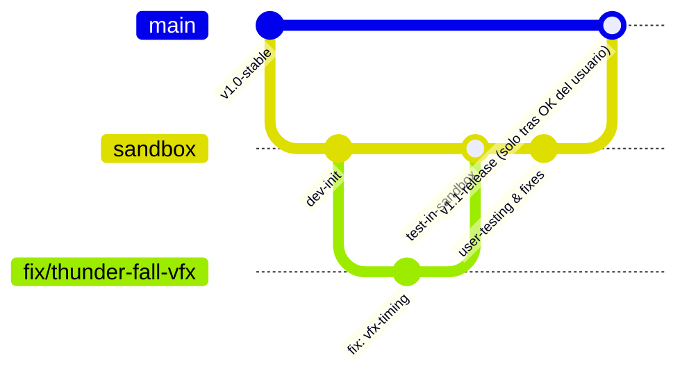

# Metodología de Desarrollo y Flujo de Ramas (Git Workflow)

Este documento describe el protocolo de trabajo acordado para el desarrollo, pruebas y publicación del mod **Stormblade**.

---

## 🌳 Arquitectura de Ramas



### 1. `main` (Producción / Versión Estable)
- Contiene **únicamente código probado, verificado y aprobado** por el usuario.
- **Regla estricta:** Nunca se comitea ni se mergea código directamente a `main` sin validación previa en juego y confirmación explícita del usuario.
- Representa las versiones finales de lanzamiento.

### 2. `sandbox` (Entorno de Pruebas y Validación)
- Es la rama de integración continua donde convergen las correcciones y nuevas mecánicas.
- Los cambios aquí son probados en caliente en el juego (*Dragons Dogma 2/reframework/...*).
- Permite depuración, rescaneo de packs VSB y ajustes finos de balance/timing antes del despliegue final.

### 3. Ramas Locales (`feature/*` o `fix/*`)
- Para cada cambio, bugfix o habilidad nueva, se crea una rama local aislada a partir de `sandbox`:
  - `fix/vfx-color-timing`
  - `feat/new-ability`
- Aísla los cambios de código para mantener la trazabilidad limpia.

---

## 🔄 Protocolo de Trabajo Paso a Paso

1. **Creación de Rama Local:**
   ```bash
   git checkout sandbox
   git pull origin sandbox  # si aplica
   git checkout -b fix/<nombre-del-cambio>
   ```

2. **Implementación y Commit del Diff:**
   - Realizar modificaciones en los archivos (`.json`, `.lua`).
   - Sincronizar cambios entre `scratch/stormblade/` y la instalación de DD2 (`Dragons Dogma 2/reframework/...`).
   - Revisar `git diff` para asegurar que solo los archivos pertinentes están siendo modificados.
   - Crear un commit descriptivo y atómico:
     ```bash
     git add <archivos>
     git commit -m "<tipo>(<alcance>): <descripción concisa>"
     ```

3. **Paso a la Rama Sandbox:**
   - Regresar a `sandbox` y fusionar la rama local:
     ```bash
     git checkout sandbox
     git merge fix/<nombre-del-cambio>
     ```

4. **Pruebas en Vivo y Feedback del Usuario:**
   - Se notifica al usuario con los detalles técnicos del cambio.
   - El usuario prueba en el juego (*Rescan Packs* / recarga de scripts).
   - Si se detectan ajustes o problemas, se itera en la rama local / sandbox.

5. **Promoción a `main` (Solo con Luz Verde):**
   - Una vez que el usuario confirma explícitamente: *"Todo funciona perfecto / Ya quedó listo"*, se promociona a `main`:
     ```bash
     git checkout main
     git merge sandbox
     ```
   - Opcionalmente se añade un tag de versión (`git tag -a vX.Y -m "Release vX.Y"`).
